# MAMedia

Reproductor de vídeo y música para el móvil y el ordenador: favoritos, listas y «seguir donde lo dejaste», zoom sin parar el vídeo, subtítulos y ecualizador. En el PC, además, catalogar y editar vídeo y música.

**Aplicación gratuita para Windows y Android desarrollada por [Masoft.es](https://masoft.es)**

- **Windows 1.7.1:** [instalador](https://github.com/MaSoft/MAMedia/releases/download/escritorio-v1.7.1/MAMedia_Setup_v1.7.1.exe) o [ejecutable único](https://github.com/MaSoft/MAMedia/releases/download/escritorio-v1.7.1/MAMedia_v1.7.1.exe)
- **Android 1.3.0:** [APK](https://github.com/MaSoft/MAMedia/releases/download/android-v1.3.0/MAMedia-1.3.0.apk)

Más información y los manuales también en [masoft.es](https://masoft.es/descargas.html#mamedia).

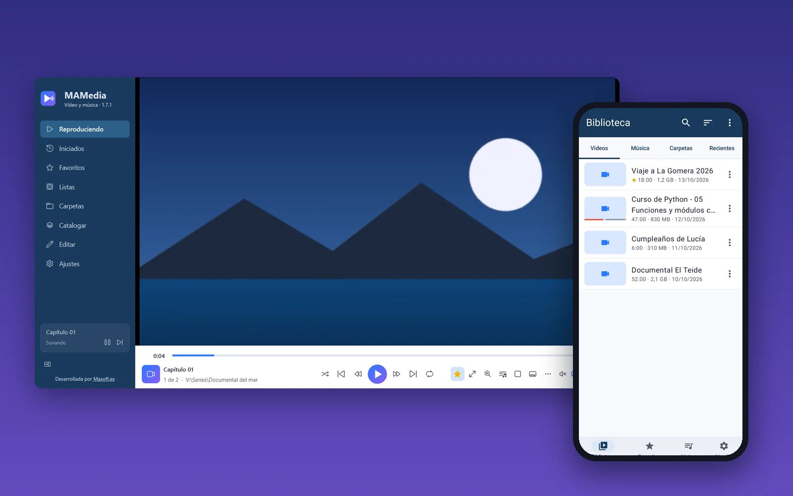

**Funcionan juntas.** Emparejados con un código QR, el PC y el móvil tienen los mismos favoritos, listas, ecualizador y por dónde ibas; se pasan archivos y el móvil reproduce las carpetas del PC por la wifi sin copiarlas. Sin cuentas ni nube.

## Windows 1.7.1

**Windows 10 / 11 · 64 bits** · [Página de la versión](https://github.com/MaSoft/MAMedia/releases/tag/escritorio-v1.7.1)

- **Instalador:** [`MAMedia_Setup_v1.7.1.exe`](https://github.com/MaSoft/MAMedia/releases/download/escritorio-v1.7.1/MAMedia_Setup_v1.7.1.exe) · 112,4 MB · SHA-256 `2feaeff69f628b6f7a9c64451dce191de812d92179db261159ede576509d731e`
- **Ejecutable único (sin instalar):** [`MAMedia_v1.7.1.exe`](https://github.com/MaSoft/MAMedia/releases/download/escritorio-v1.7.1/MAMedia_v1.7.1.exe) · 247,1 MB · SHA-256 `baa5299c2e3a3de1223b4d23c1986b48dc96b1a638e1d7a15d0d2de6466f8da0`

### Qué hace
- Casi cualquier formato de vídeo y música (MP4, MKV, AVI, HEVC, 4K, MP3, FLAC…) sin instalar códecs.
- Zoom sobre una zona del vídeo sin pararlo: rectángulo con el ratón, rueda para acercar y minimapa.
- Favoritos y listas que no copian nada, con miniatura, duración y por dónde ibas; exportar e importar .m3u.
- Mover a carpeta con sus subtítulos, desde Favoritos, Listas o la cola, aunque esté sonando.
- Catalogar: revisa cientos de vídeos o canciones con el teclado, repártelos en grupos y al final elimina, mueve o crea listas de una vez.
- Editar vídeo y música sin tocar el original: cortar, unir, quitar o cambiar el sonido, girar, zoom, subtítulos y exportar.
- Música con carátula, visualizador, sin cortes entre canciones, volumen nivelado y ecualizador de 10 bandas con 12 preajustes.
- Seguir donde lo dejaste, repetición A-B, captura de fotogramas, mini-reproductor y velocidad de 0,25× a 3×.
- Teclas multimedia, atajos e integración con Windows: «Abrir con MAMedia» y «Reproducir con MAMedia» en el clic derecho.

### Requisitos

| | |
|---|---|
| Sistema | Windows 10 u 11 (64 bits) |
| Instalación | Instalador para tu usuario, sin permisos de administrador, o ejecutable único que se copia y se abre; Python va dentro. |
| Espacio | Unos 250 MB instalado. Tus vídeos y tu música no se copian. |
| Tarjeta gráfica | Con OpenGL y su controlador instalado. |
| Pantalla | Desde 1024 × 600 |

### Capturas

| | |
|---|---|
| 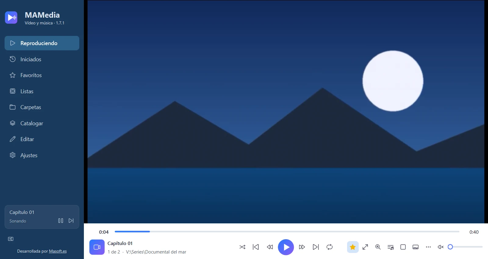 **Reproductor.** Vídeo a toda la ventana con la barra de mandos y lo que está sonando en el lateral. | 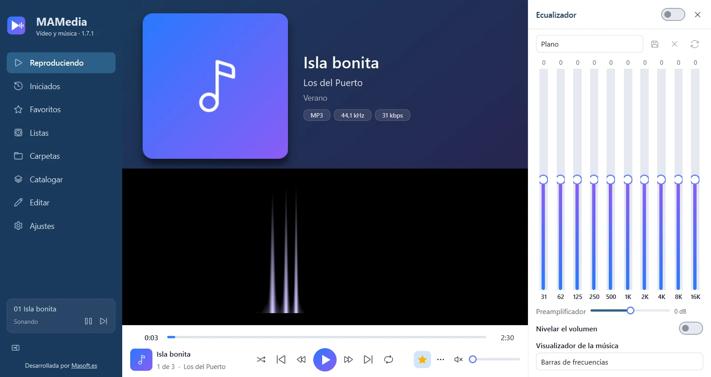 **Música y ecualizador.** Carátula, artista y álbum, visualizador y ecualizador de 10 bandas con preajustes. |
| 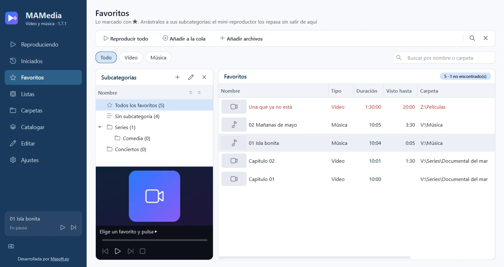 **Favoritos.** Con subcategorías, por dónde ibas y mini-reproductor para repasarlos sin salir de la lista. | 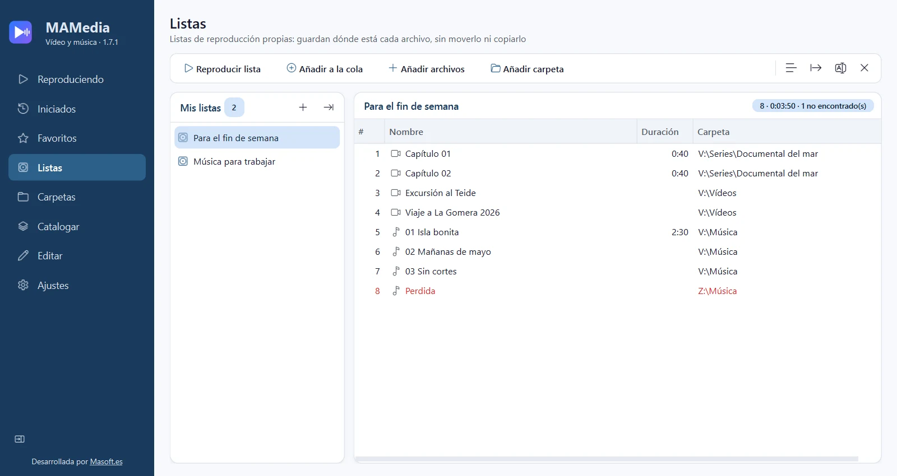 **Listas.** Listas propias sin copiar archivos; avisa de los que ya no están en su sitio. |
| 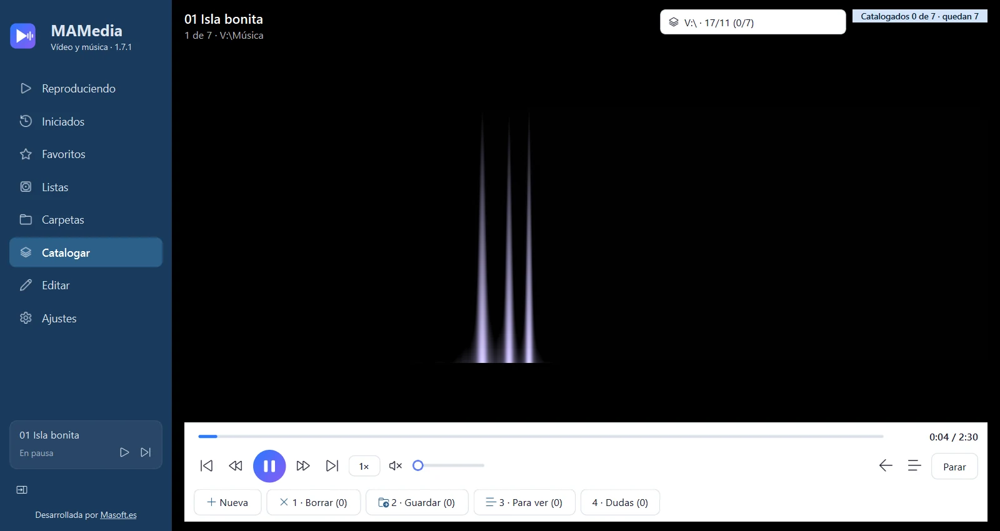 **Catalogar.** Se reparte cada archivo en su grupo con el teclado mientras suena. | 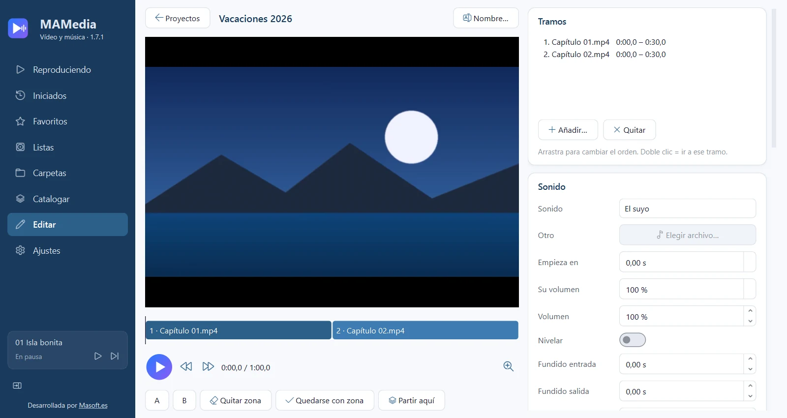 **Editar.** Tramos, sonido, imagen, zoom y subtítulos de un proyecto de vídeo. |

## Android 1.3.0

**Android 11 o superior** · [Página de la versión](https://github.com/MaSoft/MAMedia/releases/tag/android-v1.3.0)

- **APK:** [`MAMedia-1.3.0.apk`](https://github.com/MaSoft/MAMedia/releases/download/android-v1.3.0/MAMedia-1.3.0.apk) · 56,7 MB · SHA-256 `238f08a8fdc4e92e17f210d04f44e3cab15e5eefae35d8be498693cfc551a46f`

### Qué hace
- Biblioteca de vídeos, música, carpetas y recientes del móvil, sin buscar carpetas, con buscar y ordenar.
- Carpetas del móvil en árbol (memoria interna y tarjeta SD) con filtro de vídeo o música.
- Reproductor a pantalla completa con gestos: doble toque para avanzar o retroceder, deslizar para buscar, brillo y volumen.
- Zoom hasta 8× sin parar el vídeo, con minimapa, fotograma a fotograma y captura del fotograma.
- Subtítulos del vídeo y .srt, .vtt o .ass de su carpeta, pista de audio, velocidad de 0,25× a 3× y repetición A-B.
- Favoritos, listas que se ordenan arrastrando, importación y exportación de listas .m3u, y cola de reproducción.
- Música con ecualizador y preajustes, mandos en la notificación y en la pantalla de bloqueo, segundo plano e imagen en imagen.
- Abre los vídeos y la música que se comparten desde otras apps y sigue con el resto de la carpeta en orden.
- Botones de la barra del reproductor a tu gusto: cuáles se ven y en qué orden.

### Requisitos

| | |
|---|---|
| Sistema | Android 11 o superior |
| Permisos | Fotos y vídeos y Música y audio para ver tu biblioteca; notificaciones para los mandos; acceso a todos los archivos solo para mover archivos y leer los subtítulos de la carpeta. |
| Instalación | Se descarga el APK en el móvil y se abre; Android pide permiso para instalar aplicaciones de esa fuente. |
| Actualizar | La versión nueva se instala encima de la anterior sin perder nada. |

### Capturas

| | |
|---|---|
| 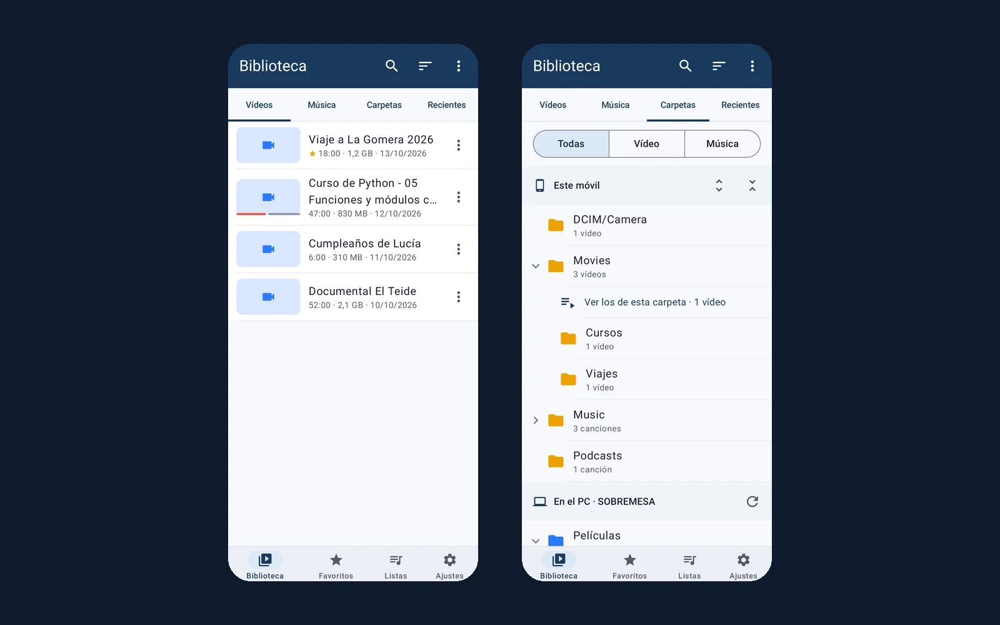 **Biblioteca y carpetas.** Vídeos del móvil con por dónde ibas, y carpetas en árbol del móvil y del PC. | 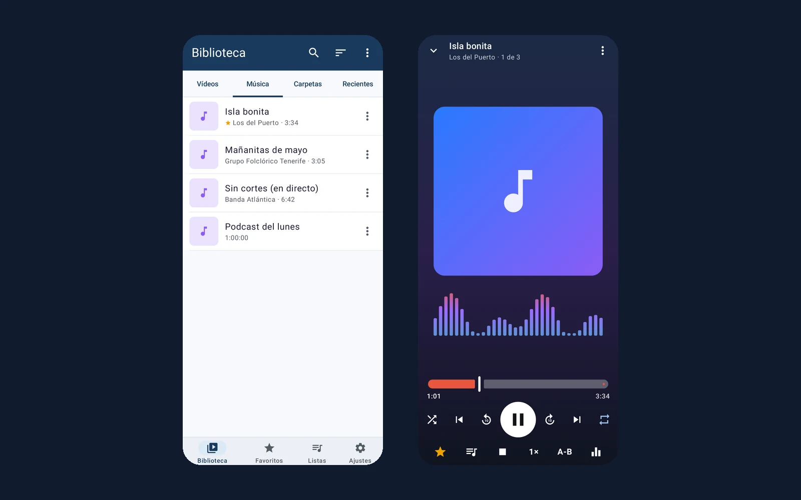 **Música.** Canciones del móvil y reproductor de música con favoritos, cola, velocidad y repetición A-B. |
| 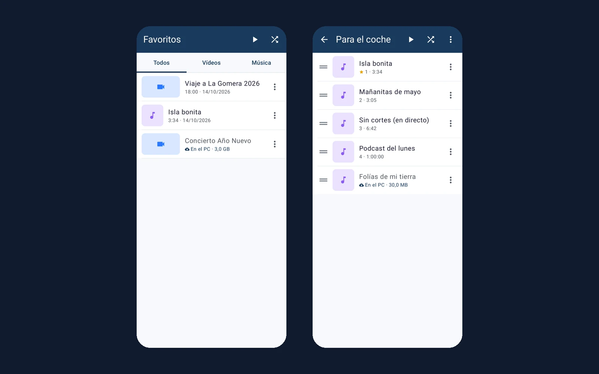 **Favoritos y listas.** Favoritos de vídeo y música y listas propias que se ordenan arrastrando. | 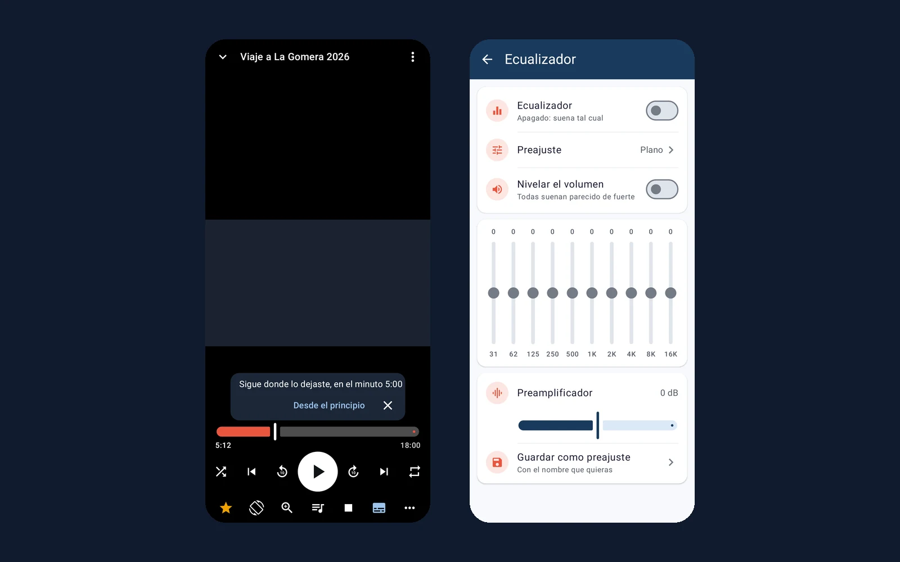 **Reproductor y ecualizador.** Reproductor de vídeo con «seguir donde lo dejaste» y ecualizador de 10 bandas con preajustes. |

## Instalación y comprobación

- **Windows:** el instalador y el ejecutable no están firmados digitalmente: Windows puede mostrar «Windows protegió su PC». Pulsa «Más información» y «Ejecutar de todas formas».
- **Android:** las aplicaciones no están en Google Play. Se descarga el APK en el móvil y se abre; Android pide permiso para instalar aplicaciones de esa fuente y Google Play Protect puede avisar de que no conoce la aplicación.

Para comprobar una descarga, en PowerShell `Get-FileHash .\<archivo>` debe dar la huella SHA-256 de arriba.

## Aviso legal

MAMedia es gratuito y se entrega tal cual, sin garantía de ningún tipo. Al descargarlo y usarlo aceptas el aviso legal y las limitaciones de su manual.

> ⚠ MAMedia reproduce los archivos que tú tienes; no descarga ni desbloquea nada. Las capturas de fotograma de películas, series o vídeos de otras personas están sujetas a sus derechos de autor y de imagen: úsalas solo para fines personales o permitidos por la ley. «Mover a carpeta» mueve archivos de verdad: comprueba el destino antes de aceptar.

**Limitaciones y exclusión de responsabilidad**
- Los vídeos con protección anticopia (DRM, como los de plataformas de pago) no se pueden reproducir.
- Favoritos, listas y posiciones se guardan en los datos de la app (Android no deja leerlos a otras apps), sin cifrar aparte.
- La app usa ExoPlayer (AndroidX Media3, licencia Apache 2.0) y los códecs del propio móvil: lo que el móvil no sabe decodificar (por ejemplo DTS en muchos modelos) no suena, aunque el vídeo se vea.
- En el PC, favoritos, listas y posiciones se guardan sin cifrar en la carpeta de datos del programa, con las rutas y los nombres de los archivos.
- MAMedia se proporciona tal cual, sin garantía de ningún tipo.

Este repositorio solo contiene las aplicaciones compiladas y su documentación. © Masoft.es. Todos los derechos reservados.
